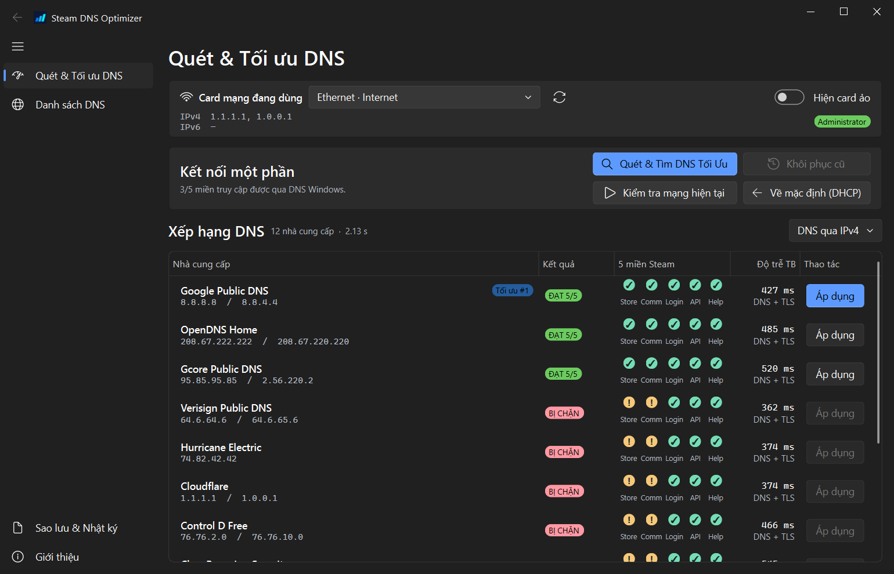
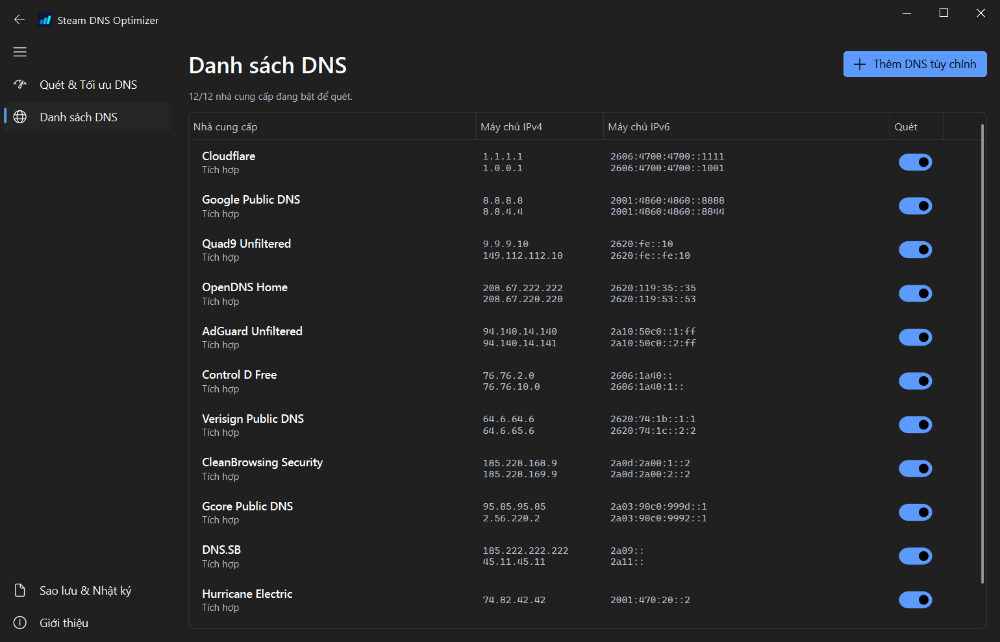
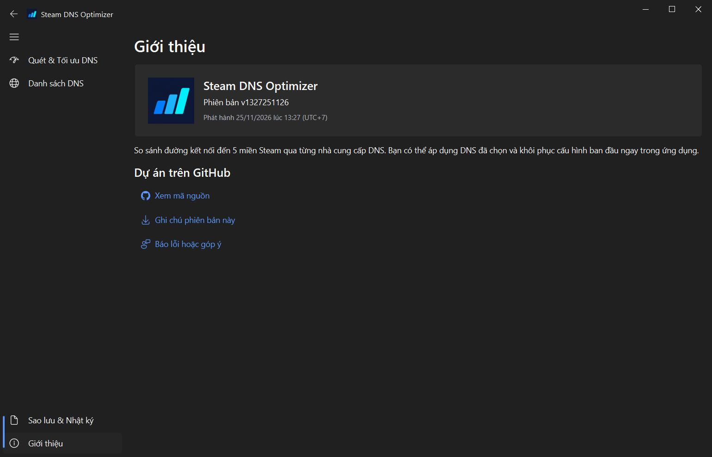

<p align="center"></p>

# Steam DNS Optimizer

Steam Store mở được nhưng Community lại không vào? Steam DNS Optimizer giúp bạn thử **12 nhà cung cấp DNS trên 5 miền Steam** bằng chính đường mạng đang dùng. Bạn thấy miền nào truy cập được và mất bao lâu, rồi mới quyết định có đổi DNS của Windows hay không.

**[Tải SteamDNSOptimizer.exe cho Windows x64](https://github.com/GiangTechiee/steam-dns-optimizer/releases/latest/download/SteamDNSOptimizer.exe)** · [Xem bản phát hành](https://github.com/GiangTechiee/steam-dns-optimizer/releases/latest) · [Góp ý hoặc báo lỗi](https://github.com/GiangTechiee/steam-dns-optimizer/issues)



*Bảng xếp hạng đến từ một lượt quét thực tế. Thông tin card mạng trong ảnh là ví dụ. Thứ tự và thời gian quét thay đổi theo đường truyền.*

## Dùng trong lần đầu

1. Tải và mở **SteamDNSOptimizer.exe**. Bản Windows x64 chạy trực tiếp và yêu cầu quyền quản trị để có thể đổi DNS khi bạn chọn **Áp dụng**.
2. Chọn Wi-Fi hoặc Ethernet đang dùng, rồi bấm **Quét & Tìm DNS Tối Ưu**. Bạn cũng có thể bấm **Kiểm tra mạng hiện tại** để đo kết nối qua DNS Windows đang sử dụng.
3. Tìm nhãn **ĐẠT 5/5**. Trong nhóm này, **Tối ưu #1** là nhà cung cấp có tổng độ trễ DNS và HTTPS trung bình thấp nhất. Di chuột lên từng chấm để xem kết quả của Store, Community, Login, API và Help.
4. Nếu muốn đổi DNS, bấm **Áp dụng** trên đúng hàng và xác nhận tên card. Ứng dụng sao lưu cấu hình gốc trước khi ghi. Chọn **Khôi phục cũ** để quay lại cấu hình đó, hoặc **Về mặc định (DHCP)** để Windows tự nhận DNS.

**Đọc kết quả.** Điểm xanh cho biết ứng dụng phân giải được IP công cộng, xác thực được chứng chỉ TLS và nhận được phản hồi HTTP từ miền đó. Nhãn **MỘT PHẦN** nghĩa là Store và Community đều truy cập được nhưng có miền phụ gặp lỗi. Cột **Độ trễ TB** đo thời gian kết nối tới dịch vụ web của Steam. Ping trong trận và tốc độ tải game là các phép đo khác.

## Chọn DNS và dùng khay hệ thống

Trong **Danh sách DNS**, bật những nhà cung cấp muốn so sánh hoặc thêm địa chỉ DNS công cộng của bạn. Trang quét cho phép chọn truy vấn qua IPv4 hoặc IPv6 khi card mạng hỗ trợ.



- **Dùng VPN hoặc card ảo** — Bật **Hiện card ảo** trên trang quét để chọn đúng giao diện mạng.
- **Thu nhỏ hoặc bấm X** — Ứng dụng nằm ở khay hệ thống. Mở EXE lần nữa sẽ đưa cửa sổ đang chạy lên trước.
- **Thoát hẳn** — Bấm chuột phải vào biểu tượng ba vạch tín hiệu màu xanh rồi chọn **Thoát hoàn toàn (Exit)**. Nếu đang ghi DNS, ứng dụng hoàn tất tác vụ trước khi thoát.
- **Cập nhật từ bản cũ** — Thoát hẳn bản đang chạy trong khay, rồi mở EXE mới. Bản sao DNS và danh sách tùy chỉnh được lưu riêng trong `%LOCALAPPDATA%\SteamDNSOptimizer`.

<details>
<summary><b>Xem trang Giới thiệu và cách đọc mã phiên bản</b></summary>

Mục **Giới thiệu** có số phiên bản, liên kết tới mã nguồn, ghi chú phát hành và trang báo lỗi. Mã dùng thứ tự **giờ · phút · ngày · tháng · năm**, mỗi phần hai chữ số theo giờ Việt Nam. Ví dụ `v1327251126` tương ứng **13:27 ngày 25/11/2026 (UTC+7)**.



</details>

## Chạy từ mã nguồn

Trên Windows với Python 3.12, mở PowerShell trong thư mục dự án.

```powershell
py -3.12 -m venv .venv
.\.venv\Scripts\python.exe -m pip install -r requirements.txt
.\.venv\Scripts\python.exe main.py
```

Để chạy kiểm thử và đóng gói EXE, dùng các lệnh sau. Bản build mặc định nằm ở `dist\SteamDNSOptimizer.exe`.

```powershell
.\.venv\Scripts\python.exe -m pip install -r requirements-dev.txt
.\.venv\Scripts\python.exe -m pytest -v
.\build.ps1
```

Tùy chọn `-AsInvoker` tạo bản chạy với quyền thường và nâng quyền khi cần. Tùy chọn `-OneDir` xuất thành thư mục. Có thể khởi động app vào khay bằng `--tray` hoặc xem mã phiên bản từ mã nguồn bằng `python main.py --version`. [Chi tiết phép đo, sao lưu và kiểm thử](docs/technical.md)

## Giấy phép

Mã nguồn riêng của dự án dùng **MIT**, cho phép dùng, sửa và phân phối lại khi giữ thông báo bản quyền. Bản EXE kết hợp thư viện giao diện GPLv3. Các điều khoản và mã nguồn của những thành phần đi kèm được liệt kê trong dự án. [MIT](LICENSE) · [Giấy phép và mã nguồn bên thứ ba](THIRD_PARTY.md)

Steam DNS Optimizer là dự án cộng đồng độc lập với Valve.
